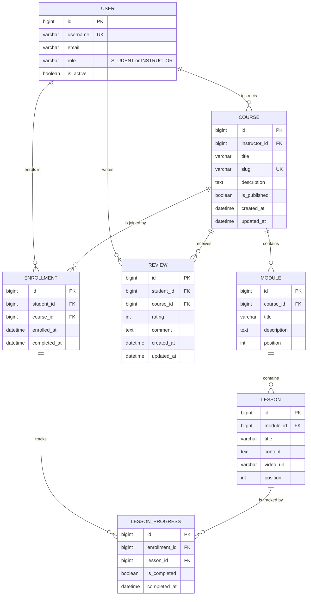

# CourseHub — Architecture & Design

> **Status:** Draft — skeleton only. Content to be agreed in the Sprint 1 design session.
>
> **Task:** `AB#TBD`
> **Branch:** `team-a/design-task` → `team-a/sprint-1`
> **Owner:** Team A
> **Last updated:** _TBD_

## Context and fixed decisions (given)

- One custom user model: `accounts.User`, based on `AbstractUser`, with a `role` field (`STUDENT` or `INSTRUCTOR`). It is already on `team-a/sprint-1`. No separate Student or Instructor user tables.

---

## 1. Entity relationship diagram (ERD)

**Required entities:** `User`, `Course`, `Module`, `Lesson`, `Enrollment`, `LessonProgress`, `Review`.

**Diagram:** Mermaid source below; GitHub renders it inline. To edit it visually, import the same block into draw.io (`Arrange > Insert > Advanced > Mermaid`) and save the export as `coursehub/docs/erd.drawio` if the team wants a diagram file in the repo.



### Plain-text view

For editors that do not render Mermaid, the same model as text:

```text
USER --1:N--> COURSE --1:N--> MODULE --1:N--> LESSON
 |               |                              |
 |               +--1:N--> ENROLLMENT           |
 |               |             |                |
 |               |             +--1:N--> LESSON_PROGRESS <--N:1--+
 |               |
 |               +--1:N--> REVIEW
 |
 +--1:N--> ENROLLMENT   (student side)
 +--1:N--> REVIEW       (student side)
```

Legend: `1:N` = one parent to many children; `N:1` = many children to one parent.

`USER` appears on both sides of the model: as the instructor who owns a `Course`, and as the student who creates an `Enrollment` or `Review`. The `role` field decides which side is valid; it is not a separate table.

### Keys and relationships

| Entity | Primary key | Foreign keys | Relationship / cardinality | Notes |
|---|---|---|---|---|
| `User` | `id` (`BigAutoField`) | — | 1 instructor → N `Course`; 1 student → N `Enrollment`; 1 student → N `Review` | `AbstractUser` + `role` (`STUDENT`/`INSTRUCTOR`). No separate Student/Instructor tables. Inherits `username` (unique), `email`, `password`, `is_active`, etc. |
| `Course` | `id` | `instructor_id` → `User` (`PROTECT`) | N `Course` → 1 instructor; 1 `Course` → N `Module`, N `Enrollment`, N `Review` | `slug` unique. `is_published` controls storefront visibility. |
| `Module` | `id` | `course_id` → `Course` (`CASCADE`) | 1 `Module` → N `Lesson` | `position` orders modules inside a course. |
| `Lesson` | `id` | `module_id` → `Module` (`CASCADE`) | 1 `Lesson` → N `LessonProgress` | `position` orders lessons inside a module. `content` and `video_url` hold the pre-recorded material. |
| `Enrollment` | `id` | `student_id` → `User` (`CASCADE`); `course_id` → `Course` (`CASCADE`) | N `Enrollment` → 1 student + 1 course; 1 `Enrollment` → N `LessonProgress` | Join model for Student ↔ Course. Unique `(student, course)`. `completed_at` is set when every lesson is complete. |
| `LessonProgress` | `id` | `enrollment_id` → `Enrollment` (`CASCADE`); `lesson_id` → `Lesson` (`CASCADE`) | N `LessonProgress` → 1 enrollment + 1 lesson | Join model for Enrollment ↔ Lesson. Unique `(enrollment, lesson)`. `is_completed` + `completed_at`. |
| `Review` | `id` | `student_id` → `User` (`CASCADE`); `course_id` → `Course` (`CASCADE`) | N `Review` → 1 student + 1 course | Unique `(student, course)`. `rating` constrained to 1–5; `comment` optional. |

### Relationship notes

- **One-to-many:** `User → Course` (instructor), `Course → Module`, `Module → Lesson`, `User → Enrollment` (student), `Course → Enrollment`, `Enrollment → LessonProgress`, `Lesson → LessonProgress`, `User → Review` (student), `Course → Review`.
- **Many-to-many:**
  - Students ↔ Courses through `Enrollment`.
  - Enrollments ↔ Lessons through `LessonProgress`, which is the through model carrying `is_completed` / `completed_at`.
- **Unique constraints:** `User.username`; `Course.slug`; `Enrollment (student, course)`; `LessonProgress (enrollment, lesson)`; `Review (student, course)`.
- **Delete behaviour:** `Course.instructor` is `PROTECT`, so an instructor who owns courses cannot be deleted. `Module`, `Lesson`, `Enrollment`, `LessonProgress` and `Review` cascade from their parent course/enrollment. Deleting a student removes their enrollments and reviews, and their progress through those enrollments.
- **Role enforcement:** the database stores a generic `User` foreign key. `Course.instructor` must be `INSTRUCTOR`, while `Enrollment.student` and `Review.student` must be `STUDENT`; enforce this in forms, services and the admin rather than with a database check.
- **Cross-field rules:** a `LessonProgress.lesson` must belong to the same course as its `Enrollment`, and a `Review` is only valid for a course the student is enrolled in. Both are application-level checks.

---

## 2. Django apps and ownership

| App | Responsibility | Owner | Status |
|---|---|---|---|
| `accounts` | Custom `User` model (`AbstractUser` + `role`: STUDENT / INSTRUCTOR), sign up, login/logout, profile, role-check decorators and mixins | _name_ | Exists — `User` model done on `team-a/sprint-1` |
| `courses` | `Course`, `Module`, `Lesson`; public catalog, course detail, instructor create/edit/publish | _name_ | App exists — models in Sprint 1 |
| `enrollments` | `Enrollment`, `LessonProgress`; enroll, "My courses", mark lesson complete, progress % | _name_ | App exists — models in Sprint 2 |
| `reviews` | `Review`; rate and review a course (enrolled students only), average rating | _name_ | App exists — models in Sprint 3 |
| `core` *(proposed)* | Home and about pages, `base.html`, navbar, shared CSS/JS | _name_ | To be created in Sprint 1 |

The scrum master reviews every PR and has the final say on its design. Every app also has a backup reviewer so work isn't blocked when the owner is away:

| App | Backup reviewer |
|---|---|
| `accounts` | _name_ |
| `courses` | _name_ |
| `enrollments` | _name_ |
| `reviews` | _name_ |
| `core` | _name_ |

### App boundaries and dependencies

- **Dependency direction:** `accounts` ← `courses` ← `enrollments` ← `reviews`. An app may import from apps to its left, never to its right. This prevents circular imports and matches the build order across sprints: each app can be built and tested once the apps it depends on exist. `core` sits at the edge and may read from any app (e.g. the home page lists published courses), but no app imports from `core`.
- **Why this split:**
  - `Module` and `Lesson` live in `courses` because they only exist inside a course and are managed by the same instructor in the same screens.
  - `LessonProgress` lives in `enrollments`, not `courses`, because it describes a student's progress through a course, not the course content itself.
  - `reviews` is its own app because it is a self-contained feature arriving later, depends on enrollment (only enrolled students can review), and can be postponed without affecting other apps.
- **What each app must not own:**
  - `accounts` must not know about courses, enrollments or reviews. No course-related fields on `User`.
  - `courses` must not track who is enrolled or their progress; it only describes content.
  - `enrollments` must not edit course content; it only reads courses and lessons.
  - `reviews` must not create enrollments; it only checks that one exists.
  - No app other than `accounts` defines user or role models. There are no separate `Student` or `Instructor` tables.
- **Shared code / utilities:**
  - Role checks (`student_required`, `instructor_required`, and class-based mixins) live in `accounts` and are imported by every app. No app writes its own `request.user.role == ...` checks.
  - Always reference the user model with `settings.AUTH_USER_MODEL` in model fields and `get_user_model()` in code, never by importing `User` directly.
  - `base.html`, the navbar and shared static files are owned by the `core` owner. Other apps extend `base.html` and don't edit it without telling the owner.
  - Project-wide files (`settings.py`, root `urls.py`, `requirements.txt`) have a single owner: _name_.

---

## 3. URL and permission table

Access levels: **Public**, **Authenticated** (any signed-in role), **Student-only**, **Instructor-only**, **Staff-only**. The brief names Public / Student-only / Instructor-only; Authenticated and Staff-only are added because `/dashboard/` is shared by both roles and `/admin/` is restricted by `is_staff`, not by course role.

| URL | Page / purpose | View | Access level | Login required | Notes |
|---|---|---|---|---|---|
| `/` | Home / landing page | `TemplateView` (`home.html`) | Public | No | Built. Links to courses, login and register. |
| `/courses/` | Course catalogue | `courses.views.course_list` | Public | No | Built as a placeholder; lists published courses only once `Course` exists. |
| `/courses/<slug>/` | Course detail, curriculum and reviews | `courses.views.course_detail` | Public | No | Planned. Unpublished courses return 404 except to the owning instructor and staff. |
| `/accounts/register/` | Student registration | `accounts.views.register` | Public | No | Built. Always creates a `STUDENT`; signed-in users are redirected to `/dashboard/`. |
| `/login/` | Login | `LoginView` with `accounts.forms.LoginForm` | Public | No | Built. |
| `/logout/` | Logout | `LogoutView` | Authenticated | Yes | Built. POST only; GET returns 405. Redirects to `/`. |
| `/dashboard/` | Role-aware dashboard | `accounts.views.dashboard` | Authenticated | Yes | Built. Students see their learning shortcuts; instructors see Creator Studio shortcuts. |
| `/my-learning/` | Student's enrolled courses | `enrollments.views.my_learning` | Student-only | Yes | Built with `login_required`; tighten to `student_required`. |
| `/my-learning/<slug>/` | Course player overview | `enrollments.views.course_player` | Student-only | Yes | Planned. Requires an `Enrollment` for the student; otherwise 404. |
| `/my-learning/<slug>/lessons/<int:lesson_id>/` | Lesson player | `enrollments.views.lesson_detail` | Student-only | Yes | Planned. The lesson must belong to the enrolled course; otherwise 404. |
| `/my-learning/<slug>/lessons/<int:lesson_id>/complete/` | Mark lesson complete | `enrollments.views.lesson_complete` | Student-only | Yes | Planned. POST only. Completes the matching `LessonProgress`. |
| `/courses/<slug>/enroll/` | Enrol in a course | `enrollments.views.enroll` | Student-only | Yes | Planned. POST only; idempotent per `(student, course)`. |
| `/courses/<slug>/reviews/` | Create a review | `reviews.views.review_create` | Student-only | Yes | Planned. POST only; requires enrolment; one review per student per course. |
| `/courses/<slug>/reviews/<int:review_id>/edit/` | Edit own review | `reviews.views.review_update` | Student-only | Yes | Planned. Author only; other students and instructors get 404. |
| `/courses/studio/` | Creator Studio landing page | `courses.views.creator_studio` | Instructor-only | Yes | Built. Guarded by `instructor_required`. |
| `/courses/studio/courses/new/` | Create a course | `courses.views.course_create` | Instructor-only | Yes | Planned. Sets `instructor` to `request.user`. |
| `/courses/studio/courses/<slug>/edit/` | Edit course details | `courses.views.course_update` | Instructor-only | Yes | Planned. Owner only; other instructors get 404. |
| `/courses/studio/courses/<slug>/modules/` | Manage modules and lessons | `courses.views.course_curriculum` | Instructor-only | Yes | Planned. Owner only; covers module/lesson create, reorder and delete. |
| `/courses/studio/courses/<slug>/publish/` | Publish or unpublish | `courses.views.course_publish` | Instructor-only | Yes | Planned. POST only; owner only; toggles `is_published`. |
| `/admin/` | Django admin | `admin.site.urls` | Staff-only | Yes | Built. Requires `is_staff`; used to promote a user by setting `role=INSTRUCTOR`. |

### Permission rules

- **Guest behaviour:** every route with **Login required = Yes** runs `login_required` / `LoginRequiredMixin` as the outermost check. A guest gets **302 to `/login/?next=<original URL>`**, never 403 — even on student-only or instructor-only pages. Django validates `next`, so it cannot be used as an open redirect. Public routes never redirect.
- **Wrong authenticated role:** a signed-in user with the wrong role gets **403 Forbidden** (`PermissionDenied`). Students on instructor-only pages and instructors on student-only pages are both rejected; the role is never silently downgraded. Instructors may still read public course detail pages, but cannot enrol or review.
- **Object-level rules:** role checks alone are not enough. Student routes scope querysets through `Enrollment.objects.filter(student=request.user)`, and objects outside that scope return **404**, not 403, so IDs cannot be probed. Instructor studio routes scope through `Course.objects.filter(instructor=request.user)`. Review edits scope to the author. Staff override ownership only inside `/admin/`.
- **Method rules:** logout, enrol, lesson completion, publish/unpublish and review create/edit are **POST only** with CSRF protection; a GET returns 405. Read pages are GET.
- **Where enforcement lives:** role checks use `accounts.decorators.instructor_required` and a matching `student_required` for function views, plus `InstructorRequiredMixin` / `StudentRequiredMixin` for class-based views. Ownership is enforced by scoped `get_queryset()` or an explicit check in the view or service layer. Templates only hide links (``) and are **never** the security boundary — the view still enforces the rule. Admin access relies on `is_staff`, not on `role`.
- **Post-success redirects:** login and registration → `/dashboard/`; logout → `/`; enrolment → `/my-learning/<slug>/`; review create/edit → the course detail page.

---

## 4. Conventions

## 4. Conventions

### Naming

- **Apps:** lowercase, plural nouns for apps that hold a collection of things (`accounts`, `courses`, `enrollments`, `reviews`), `core` for shared pages. No hyphens or underscores.
- **Models:** singular `PascalCase` (`Course`, `LessonProgress`, not `Courses`). Foreign keys are named after the related object, not its id (`instructor`, not `instructor_id`). Every FK and M2M sets `related_name` in plural (`course.modules`, `user.enrollments`). Every model defines `__str__`.
- **Views and URLs:**
  - View functions in `snake_case`, class-based views in `PascalCase` ending in `View` (`course_detail`, `CourseCreateView`).
  - Each app has its own `urls.py` with `app_name` set, included from the root `urls.py` with a prefix (`courses/`, `accounts/`, ...).
  - URL names follow `<model>_<action>` (agreed by the team), using only these actions: `list`, `detail`, `create`, `update`, `delete` (e.g. `course_list`, `course_detail`, `course_create`, `course_update`, `course_delete`). Use `update`, not `edit`; `delete`, not `remove`. Actions outside these five use a clear verb in the same pattern (`course_enroll`, `lesson_complete`).
  - URL names are always referenced with their app namespace (``, `reverse("courses:course_list")`). No hard-coded paths in templates or views.
  - URL paths are lowercase with hyphens (`my-courses/`, not `my_courses/`).
- **Templates:** lowercase `snake_case`, named after the page (`course_list.html`, `course_detail.html`, `course_form.html`). Partials start with an underscore (`_navbar.html`, `_course_card.html`).
- **Tests:** in `<app>/tests/` once an app has more than one test file (`test_models.py`, `test_views.py`), otherwise `<app>/tests.py`. Test classes end in `Tests` (`CourseModelTests`); test methods describe the behaviour (`test_draft_courses_hidden_from_catalog`). Run `python manage.py test` before every PR.
- **Branches and commits:** see `CONTRIBUTING.md`. Branches: `feature/<name>-<task-number>-<short-description>` (e.g. `feature/walid-3301-course-detail`), branched from and merged back into `team-a/sprint-<n>`. Commits: short imperative summary that says what changed (`Add Course model and admin`, not `fixes` or `update`). PR titles include the task number.

### Templates

- **Project-level template directory:** `templates/` at the project root, registered in `TEMPLATES["DIRS"]` as `BASE_DIR / "templates"`. Holds only shared layout: `base.html` and `partials/`.
- **App-level template directory:** each app keeps its own pages in `<app>/templates/<app>/` (e.g. `courses/templates/courses/course_list.html`). The repeated app name is deliberate: it namespaces templates so two apps can both have a `detail.html` without clashing. Requires `APP_DIRS: True` (Django's default).
- **Naming pattern:** `<app>/<page>.html`, rendered as `render(request, "courses/course_list.html", ...)`. Every page template starts with `` and fills `` and ``.
- **Shared partials:** site-wide pieces (navbar, footer, messages) in `templates/partials/`, included with ``. Partials used by only one app stay in that app's template folder (`courses/_course_card.html`). Changes to `base.html` or `templates/partials/` need the `core` owner's review.

### Static files

- **CSS / JS / images location:**
  - Site-wide assets in `static/` at the project root (`static/css/main.css`, `static/js/main.js`, `static/img/`), registered with `STATICFILES_DIRS = [BASE_DIR / "static"]`.
  - App-specific assets in `<app>/static/<app>/` (e.g. `courses/static/courses/css/catalog.css`), namespaced like templates.
  - Always loaded with `` and ``, never hard-coded `/static/...` paths.
  - User uploads (course thumbnails) are **media**, not static: stored in `media/` (`MEDIA_ROOT`), served at `/media/` in development only, and listed in `.gitignore`.
- **Static URL and collection:** `STATIC_URL = "static/"`. For deployment, `STATIC_ROOT = BASE_DIR / "staticfiles"` and `python manage.py collectstatic`; `staticfiles/` is in `.gitignore`. In development, `runserver` serves static files automatically when `DEBUG = True`.
- **Third-party assets (CDN vs vendored):** we use **Bootstrap 5** (agreed by the team) from the jsDelivr CDN, with the exact version pinned, linked once in `base.html`: CSS in `<head>`, the JS bundle just before `</body>`. The tags are copied from the official Bootstrap quick-start page, including `integrity` attributes. No other template links Bootstrap. Our own styles go in `static/css/main.css`, loaded *after* Bootstrap so they can override it; Bootstrap's own files are never edited or copied. Reasons for the CDN: nothing extra to commit, and the whole team uses the same version. If we later need offline work or deployment without internet access, we switch to vendored copies in `static/vendor/`. Adding any other library needs a short note in the PR explaining why.

## 5. Sprint 1 in detail

### Goal

_TBD_

### Scope

- In scope: _TBD_
- Out of scope: _TBD_

### Deliverables

- _TBD_

### Definition of Done

- _TBD_

### Task split

| Task | Task number | Owner | Depends on | Definition of Done |
|---|---|---|---|---|
| _TBD_ | _TBD_ | _TBD_ | _TBD_ | _TBD_ |

---

## 6. Sprints 2–4 (rough sketch)

### Sprint 2

- Theme: _TBD_
- Main features: _TBD_
- Models touched: _TBD_
- Risks: _TBD_

### Sprint 3

- Theme: _TBD_
- Main features: _TBD_
- Models touched: _TBD_
- Risks: _TBD_

### Sprint 4

- Theme: _TBD_
- Main features: _TBD_
- Models touched: _TBD_
- Risks: _TBD_

---

## Decisions log

| Date | Decision | Rationale | Agreed by |
|---|---|---|---|
| _TBD_ | _TBD_ | _TBD_ | _TBD_ |

## Open questions

- _TBD_

## Group sign-off

| Name | Role | Agreed |
|---|---|---|
| _TBD_ | _TBD_ | _TBD_ |
