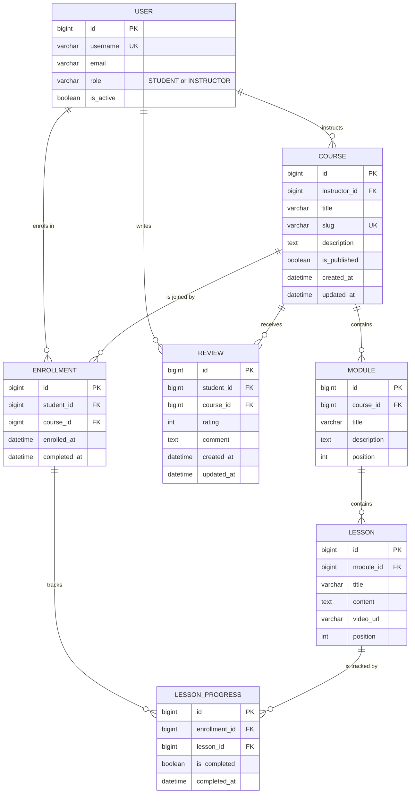

# CourseHub — Architecture & Design

> **Status:** Draft — skeleton only. Content to be agreed in the Sprint 1 design session.
>
> **Task:** `AB#TBD`
> **Branch:** `team-a/design-task` → `team-a/sprint-1`
> **Owner:** Team A
> **Last updated:** _TBD_

## Context and fixed decisions (given)

- One custom user model: `accounts.User`, based on `AbstractUser`, with a `role` field (`STUDENT` or `INSTRUCTOR`). It is already on `team-a/sprint-1`. No separate Student or Instructor user tables.

---

## 1. Entity relationship diagram (ERD)

**Required entities:** `User`, `Course`, `Module`, `Lesson`, `Enrollment`, `LessonProgress`, `Review`.

**Diagram:** Mermaid source below; GitHub renders it inline. To edit it visually, import the same block into draw.io (`Arrange > Insert > Advanced > Mermaid`) and save the export as `coursehub/docs/erd.drawio` if the team wants a diagram file in the repo.



### Plain-text view

For editors that do not render Mermaid, the same model as text:

```text
USER --1:N--> COURSE --1:N--> MODULE --1:N--> LESSON
 |               |                              |
 |               +--1:N--> ENROLLMENT           |
 |               |             |                |
 |               |             +--1:N--> LESSON_PROGRESS <--N:1--+
 |               |
 |               +--1:N--> REVIEW
 |
 +--1:N--> ENROLLMENT   (student side)
 +--1:N--> REVIEW       (student side)
```

Legend: `1:N` = one parent to many children; `N:1` = many children to one parent.

`USER` appears on both sides of the model: as the instructor who owns a `Course`, and as the student who creates an `Enrollment` or `Review`. The `role` field decides which side is valid; it is not a separate table.

### Keys and relationships

| Entity | Primary key | Foreign keys | Relationship / cardinality | Notes |
|---|---|---|---|---|
| `User` | `id` (`BigAutoField`) | — | 1 instructor → N `Course`; 1 student → N `Enrollment`; 1 student → N `Review` | `AbstractUser` + `role` (`STUDENT`/`INSTRUCTOR`). No separate Student/Instructor tables. Inherits `username` (unique), `email`, `password`, `is_active`, etc. |
| `Course` | `id` | `instructor_id` → `User` (`PROTECT`) | N `Course` → 1 instructor; 1 `Course` → N `Module`, N `Enrollment`, N `Review` | `slug` unique. `is_published` controls storefront visibility. |
| `Module` | `id` | `course_id` → `Course` (`CASCADE`) | 1 `Module` → N `Lesson` | `position` orders modules inside a course. |
| `Lesson` | `id` | `module_id` → `Module` (`CASCADE`) | 1 `Lesson` → N `LessonProgress` | `position` orders lessons inside a module. `content` and `video_url` hold the pre-recorded material. |
| `Enrollment` | `id` | `student_id` → `User` (`CASCADE`); `course_id` → `Course` (`CASCADE`) | N `Enrollment` → 1 student + 1 course; 1 `Enrollment` → N `LessonProgress` | Join model for Student ↔ Course. Unique `(student, course)`. `completed_at` is set when every lesson is complete. |
| `LessonProgress` | `id` | `enrollment_id` → `Enrollment` (`CASCADE`); `lesson_id` → `Lesson` (`CASCADE`) | N `LessonProgress` → 1 enrollment + 1 lesson | Join model for Enrollment ↔ Lesson. Unique `(enrollment, lesson)`. `is_completed` + `completed_at`. |
| `Review` | `id` | `student_id` → `User` (`CASCADE`); `course_id` → `Course` (`CASCADE`) | N `Review` → 1 student + 1 course | Unique `(student, course)`. `rating` constrained to 1–5; `comment` optional. |

### Relationship notes

- **One-to-many:** `User → Course` (instructor), `Course → Module`, `Module → Lesson`, `User → Enrollment` (student), `Course → Enrollment`, `Enrollment → LessonProgress`, `Lesson → LessonProgress`, `User → Review` (student), `Course → Review`.
- **Many-to-many:**
  - Students ↔ Courses through `Enrollment`.
  - Enrollments ↔ Lessons through `LessonProgress`, which is the through model carrying `is_completed` / `completed_at`.
- **Unique constraints:** `User.username`; `Course.slug`; `Enrollment (student, course)`; `LessonProgress (enrollment, lesson)`; `Review (student, course)`.
- **Delete behaviour:** `Course.instructor` is `PROTECT`, so an instructor who owns courses cannot be deleted. `Module`, `Lesson`, `Enrollment`, `LessonProgress` and `Review` cascade from their parent course/enrollment. Deleting a student removes their enrollments and reviews, and their progress through those enrollments.
- **Role enforcement:** the database stores a generic `User` foreign key. `Course.instructor` must be `INSTRUCTOR`, while `Enrollment.student` and `Review.student` must be `STUDENT`; enforce this in forms, services and the admin rather than with a database check.
- **Cross-field rules:** a `LessonProgress.lesson` must belong to the same course as its `Enrollment`, and a `Review` is only valid for a course the student is enrolled in. Both are application-level checks.

---

## 2. Django apps and ownership

| App | Responsibility | Owner | Status |
|---|---|---|---|
| _TBD_ | _TBD_ | _TBD_ | _TBD_ |

### App boundaries and dependencies

- Dependency direction: _TBD_
- What each app must not own: _TBD_
- Shared code / utilities: _TBD_

---

## 3. URL and permission table

Access levels: **Public**, **Student-only**, **Instructor-only**.

| URL | Page / purpose | View | Access level | Login required | Notes |
|---|---|---|---|---|---|
| _TBD_ | _TBD_ | _TBD_ | _TBD_ | _TBD_ | _TBD_ |

### Permission rules

- Guest behaviour (302 to login vs 403): _TBD_
- Student behaviour on instructor-only pages: _TBD_
- Instructor behaviour on student-only pages: _TBD_
- Where enforcement lives (decorator, mixin, view, template): _TBD_

---

## 4. Conventions

### Naming

- Apps: _TBD_
- Models: _TBD_
- Views and URLs: _TBD_
- Templates: _TBD_
- Tests: _TBD_
- Branches and commits (see `CONTRIBUTING.md`): _TBD_

### Templates

- Project-level template directory: _TBD_
- App-level template directory: _TBD_
- Naming pattern (`<app>/<page>.html`): _TBD_
- Shared partials: _TBD_

### Static files

- CSS / JS / images location: _TBD_
- Static URL and collection: _TBD_
- Third-party assets (CDN vs vendored): _TBD_

---

## 5. Sprint 1 in detail

### Goal

_TBD_

### Scope

- In scope: _TBD_
- Out of scope: _TBD_

### Deliverables

- _TBD_

### Definition of Done

- _TBD_

### Task split

| Task | Task number | Owner | Depends on | Definition of Done |
|---|---|---|---|---|
| _TBD_ | _TBD_ | _TBD_ | _TBD_ | _TBD_ |

---

## 6. Sprints 2–4 (rough sketch)

### Sprint 2

- Theme: _TBD_
- Main features: _TBD_
- Models touched: _TBD_
- Risks: _TBD_

### Sprint 3

- Theme: _TBD_
- Main features: _TBD_
- Models touched: _TBD_
- Risks: _TBD_

### Sprint 4

- Theme: _TBD_
- Main features: _TBD_
- Models touched: _TBD_
- Risks: _TBD_

---

## Decisions log

| Date | Decision | Rationale | Agreed by |
|---|---|---|---|
| _TBD_ | _TBD_ | _TBD_ | _TBD_ |

## Open questions

- _TBD_

## Group sign-off

| Name | Role | Agreed |
|---|---|---|
| _TBD_ | _TBD_ | _TBD_ |
